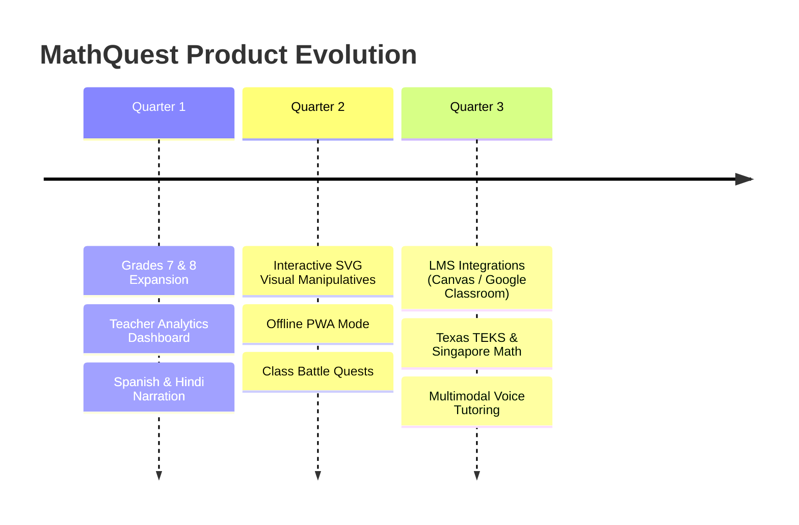

# MathQuest: Product & Engineering Roadmap

This roadmap outlines the post-assessment vision, feature milestones, and expansion trajectory for **MathQuest** as it transitions into client production.

---

## 🗺️ Milestone Overview

---

## Phase 1: Near-Term Enhancements (Months 1–3)

### 1.1 Curriculum & Grade Expansion
- **Georgia MGSE Grades 7 & 8**:
  - Linear expressions, equations, and inequalities (`MGSE7.EE`).
  - Proportional relationships and slope (`MGSE8.EE`).
  - Pythagorean theorem and irrational numbers (`MGSE8.NS`, `MGSE8.G`).
- **CBSE Classes 7 & 8 (*NCERT*)**:
  - Rational numbers and linear equations in one variable.
  - Algebraic expressions, identities, and factorisation.
- **US State Standards**:
  - Texas Essential Knowledge and Skills (TEKS) Grades 5 & 6.
  - California Common Core State Standards (CCSS).
- *Implementation*: Only requires authoring JSON packs in `backend/data/packs/` and curriculum markdown summaries—zero application code changes.

### 1.2 Teacher & Classroom Experience
- **Teacher Dashboard**:
  - Class generation with 6-character room codes.
  - Real-time misconception heatmaps highlighting common class-wide errors (e.g. 64% of students added denominators in fraction addition).
  - Printable, standards-aligned PDF student mastery summaries.
- **Assignment Mode**:
  - Teachers assign targeted topic quests with custom tier constraints (e.g., "Complete 5 Hard Geometry problems with 80% accuracy").

### 1.3 Multilingual Narration
- Dual-immersion support for Georgia elementary schools (Spanish audio narration).
- Regional language audio for CBSE schools (Hindi, Tamil, Marathi) using Web Speech API and edge-cached neural TTS.

---

## Phase 2: Engagement & Offline Accessibility (Months 4–6)

### 2.1 Interactive Mathematical Manipulatives
- Dynamic, interactive SVG diagrams allowing students to visually test fractions:
  - Drag-and-drop fraction bars and fraction strips.
  - Interactive geometric shape resizing (live width/length adjustment showing real-time perimeter vs. area calculation).
  - Number line slider for negative integers and decimal place value.

### 2.2 Offline Progressive Web App (PWA)
- Full service worker offline caching for schools with intermittent broadband connectivity.
- Client-side TypeScript exact rational arithmetic engine mirroring `verify.py`, allowing complete offline question grading without server round-trips.

### 2.3 Collaborative Gamification ("Class Quests")
- Team-based boss battles: students solve math problems in parallel to power up their class team and defeat dragon challenges.
- Avatar shop using non-monetized quest XP (unlocking whimsical math wizard hats, cloaks, and pets).

---

## Phase 3: Enterprise & Multimodal Learning (Months 7–12)

### 3.1 Learning Management System (LMS) Integration
- **LTI 1.3 Advantage Certification**:
  - 1-click single sign-on (SSO) via Google Classroom, Clever, and Canvas.
  - Automatic gradebook synchronization (passing mastery scores directly to teacher gradebooks).

### 3.2 Multimodal Socratic Voice Tutoring
- Gemini Live bidirectional voice streaming:
  - Students explain their reasoning verbally (*"I think I need to multiply the tops and bottoms by 3..."*).
  - The voice assistant identifies the exact cognitive inflection point where student reasoning diverged from mathematical truth and gently prompts with a guiding question rather than giving away the answer.

### 3.3 International Board Expansions
- **Singapore Math**: Concrete-Pictorial-Abstract (CPA) bar-model word problem generators.
- **UK National Curriculum**: Key Stage 2 (Year 6 SATs) & Key Stage 3.
- **IB Primary Years Programme (PYP)**: Inquiry-based math quests.
